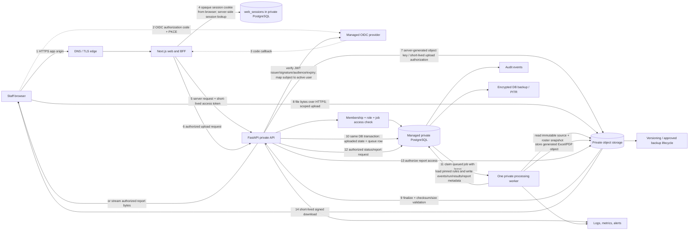
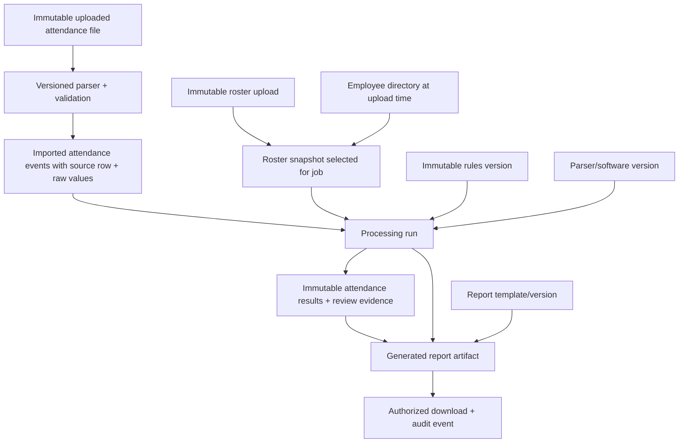
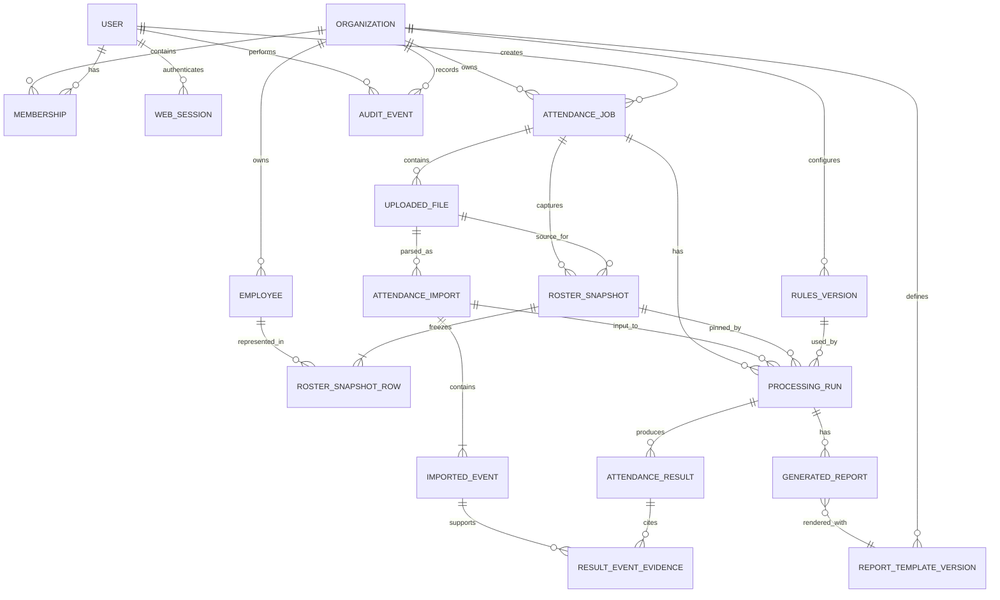
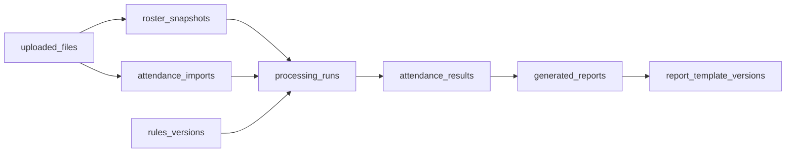
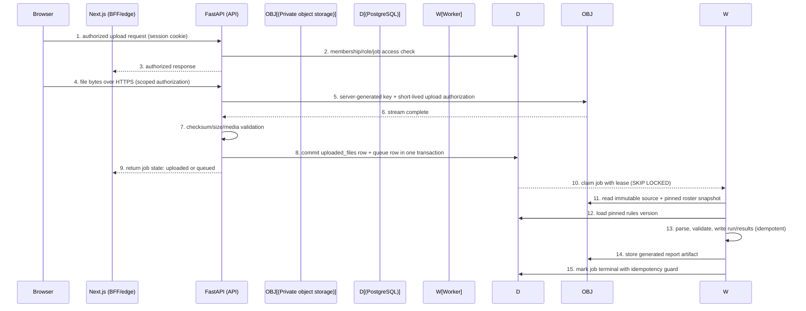
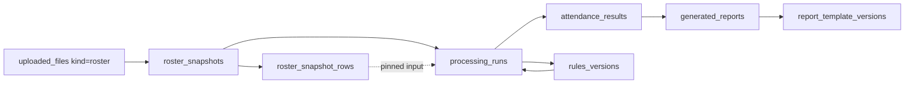
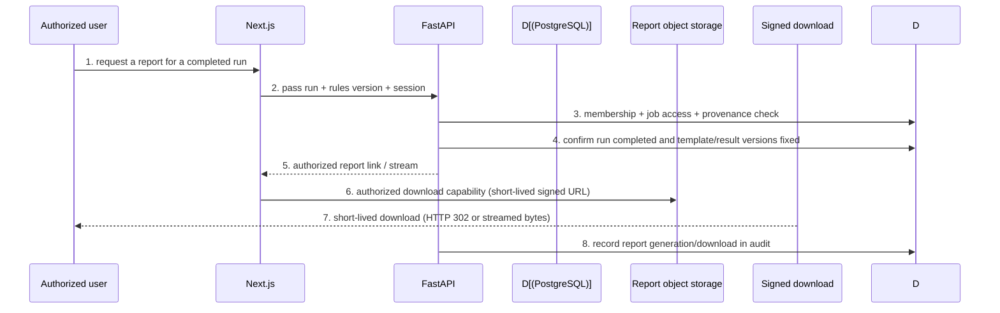

# MM&RJD Attendance System — Cloud Architecture Proposal

**Prepared:** 2026-10-30
**Purpose:** Reviewable target architecture and implementation sequence. This is a proposal, not deployment approval or an implementation authorization. No hosting account, paid service, real employee record, or live attendance service was used.

## 1. Executive recommendation

**Recommend a single-organization deployment for MM&RJD for the first release.** Build the product as one organization with a small, explicit organization boundary in the data model, but do not build a self-service SaaS tenant lifecycle, billing, custom domains, or tenant administration yet. This keeps authorization and data ownership testable for the initial user group while preserving a path to a future SaaS product.

For the first production-capable architecture, keep the Next.js and FastAPI applications, and add managed identity, managed PostgreSQL, private object storage, and one isolated processing worker. Begin with a **PostgreSQL-backed durable job queue** in the same managed database rather than introducing SQS at initial scale. Keep the API, worker, database, and bucket private. Route browser traffic through one application origin so the browser does not need broad CORS access. Move the queue to a managed queue service only when measured throughput, isolation, or queue operations justify the additional component.

This is more operational work than an all-in-one developer platform, but gives the application direct control over job ownership, private storage, worker isolation, database backups, and network boundaries. If the organization has no AWS operational capacity, a managed platform such as Render with managed Postgres and a private worker is a reasonable simpler alternative, subject to a security and data-region review. Vercel can host the Next.js layer but should not be the default home for the Python processing service and sensitive job files without a reviewed split-service design.

**Not approved by this proposal:** public deployment, live employee records, payroll decisions, or a multi-organization SaaS launch. HR rules, data residency, retention duration, recovery objectives, and account ownership require named owners' decisions first.

## 2. Evidence, assumptions, and recommendations

### Verified from the current repository and reports

- The application is a Next.js 14/React 18 frontend and FastAPI backend. Existing routes are `/`, `/upload`, `/results`, and `/rules`.
- Current API contracts include attendance upload, roster upload, explicit job processing, job status, rules, and Excel/PDF exports. There is no authentication, account, organization, role, or job-owner model in the current implementation.
- Jobs and source/result JSON are currently stored under a host temporary directory; effective rules are mutable process-local state. Neither arrangement supports reliable multiple-worker production use.
- Frontend session storage contains job/result state. It is a convenience cache, not an access-control or durable record store.
- The system has unresolved policy questions around late thresholds, missing checkout/default end, and weekend overtime. These must remain explicit until the policy owner decides them.
- Recent browser verification covered synthetic uploads and actual report downloads, but did not establish production readiness or all browser workflows.

### Planning assumptions to validate

- First release serves one legal organization, MM&RJD, with a small administrator-managed staff cohort.
- Users need remote access by URL but not anonymous/self-service registration.
- First release can operate in one approved cloud region and tolerate a planned maintenance window. No availability, RTO, or RPO target has been supplied.
- Attendance files contain sensitive employee identifiers and time records. Treat raw uploads, rosters, results, exports, and audit events as confidential personal data.
- Traffic volume, data residency, retention, file variants, user count, and budget are unknown. Cost ranges below are planning estimates, not vendor quotes.

## 3. Product model decision

| Direction | Benefits | Costs and risks | Recommendation |
|---|---|---|---|
| One MM&RJD organization | Small operational model; one rules authority; no tenant onboarding or billing; clearer authorization review; simpler support and migration | The system still needs robust per-user permissions and job ownership; future client separation needs deliberate expansion | **Choose for first release** |
| Multi-organization SaaS | Supports future customers and centralized product operations; organization-scoped rules and data are first-class | Requires tenant lifecycle, cross-tenant isolation, organization admins, support access controls, onboarding, billing/contracting, tenant-level retention, and stronger abuse controls; no present evidence that this is required | Defer until a named customer and product owner authorize the SaaS direction |

Store an `organization_id` on business records from the beginning and create exactly one initial organization row. Enforce it in server queries and foreign keys. Do not implement tenant self-service or present a tenant switcher in this phase. This is a low-cost future-proofing measure, not proof of SaaS isolation. Before future SaaS use, add explicit cross-tenant isolation tests, tenant-aware object keys and policies, support/admin boundaries, migration review, and a security assessment.

## 4. Proposed system architecture



The browser never receives database, object-store, or queue credentials. Steps 7–8 may be API-streamed instead of presigned upload if file sizes and API bandwidth make that simpler. In either case, API finalization validates the stored object before enqueueing. The same-origin edge routes web traffic; FastAPI, PostgreSQL, the queue table, worker, session store, and object storage remain private. The diagram's access-token hop is server-to-server; the browser holds only the opaque session cookie.

### Upload-to-report provenance



Every report references one processing run. That run references the exact source file, canonical imported-event set, roster snapshot, immutable rules version, parser/software version, and report template version. Roster or rule changes create new versions and do not rewrite prior runs. This is how the system can reproduce a historical report while preserving the original inputs and calculation context. If policy requires deleting a source object, retain only the minimum approved canonical evidence and provenance needed for reproducibility; if that evidence is also deleted, the system must label the old report as no longer reproducible rather than implying otherwise.

### Component responsibilities

| Component | Responsibility | Boundary |
|---|---|---|
| DNS + HTTPS edge | Domain, TLS termination, request routing, basic WAF/rate limits, upload request-size cap | Only public entry point; routes only required web/API paths |
| Next.js web | UI, authenticated session presentation, server-side proxy/BFF where useful | No service-role credentials in client bundles; do not trust client-supplied user or organization IDs |
| Managed identity provider | Sign-in, MFA, verification, password reset, token/session issuance | Authentication only; application still performs authorization for every operation |
| FastAPI API | Validate identity, authorization, job commands, upload metadata, rules, status, exports/download authorization | Private service; verifies job owner/org on every request |
| PostgreSQL | Durable authoritative users/memberships, jobs, rules versions, processing state, metadata, audit trail | Private subnet; least-privileged service credentials; encrypted backups |
| Object storage | Raw attendance file, roster, generated report artifacts | Private bucket/container; random server-generated keys; encryption and retention policies |
| Queue | Durable dispatch of processing work and retries | Message includes opaque job/run IDs only; worker rechecks job state and authorization context |
| Processing worker | Parse and process one explicitly selected job; write versioned result; generate reports | No public ingress; bounded concurrency, CPU/memory/time limits, least-privileged storage permissions |
| Monitoring and alerting | Request/error rates, queue age, job failures, resource use, security events, cost | Logs redact attendance values and tokens; access to logs is limited and audited |

For the first release, keep Next.js and FastAPI as separate deployable services, even if they share one repository and CI pipeline. Run exactly one private worker initially. Processing and report generation happen asynchronously so uploads and longer work do not occupy the interactive API process. The queue choice is detailed in Section 4.1.

### 4.1 Initial queue decision

| Queue approach | Advantages | Costs/limitations | Appropriate trigger |
|---|---|---|---|
| **PostgreSQL-backed queue table (recommended initially)** | No new infrastructure service; job state and queue intent can commit in the same transaction; durable under managed DB backup; simple operational footprint for one worker and low volume | Polling adds DB load; workers need correct lease/claim logic; a poison job can occupy retries unless bounded; queue throughput competes with application queries; DB restore/recovery also affects queue | Initial MM&RJD workload, one worker, modest job volume. Use `SELECT … FOR UPDATE SKIP LOCKED` or equivalent short claim transaction, lease expiry, attempt counter, `available_at`, and dead-letter/failed state. Never hold a transaction while parsing a file. |
| **Managed queue such as SQS** | Independent queue scaling; visibility timeout, redrive/dead-letter support; isolates task bursts from database; supports adding workers without polling the application DB | New service, IAM policies, alarms, message lifecycle and operational cost; queue state is separate from DB, so requires transactional outbox or idempotent reconciliation to avoid committed jobs with missing messages (and the reverse) | Add when measured queue volume, burstiness, worker count, database contention, or need for separate queue failure handling justifies it. |

For the database-backed option, write the job state transition and queue row in one database transaction. The worker claims a row in a short transaction, commits a lease, performs work outside the transaction, and then commits results plus terminal job state atomically. A periodic recovery task reclaims expired leases after worker crash; retries use bounded exponential backoff and a maximum attempt count, then mark a terminal failed state for operator review. Use idempotency keys and unique result/run constraints. Keep the single worker process supervised and observable. Adding workers later requires only safe concurrent claims and bounded resource settings; switching to SQS later should use an outbox rather than dual writes.

### Worker scaling path and further queue options

Start with one private worker container and the PostgreSQL queue table. The single worker claims jobs with `SELECT ... FOR UPDATE SKIP LOCKED` (or equivalent) inside a short transaction, holds a lease with a bounded expiry, and uses idempotency keys so a restart or double claim cannot duplicate results. It rejects obsolete leases and moves genuinely unrecoverable work to a terminal failed state for operator review.

Adding workers later is a deployment decision, not a schema change: each worker independently claims the next available row, and concurrency is bounded per worker by CPU, memory, and time limits. The queue table is already the scaling point, so adding workers requires no data migration. If jobs exceed one worker's throughput or are bursty enough to justify it, add workers in parallel.

Move to a managed queue such as SQS only when measured throughput, database contention, burstiness, or the need to isolate queue failures justifies a new component. When that day comes, use an outbox pattern rather than dual writes, and plan IAM, dead-letter/redrive, alarms, and reconciliation as part of that migration.

## 5. User access model

### Roles

Use three application roles plus a tightly controlled platform operator role. Keep authorization coarse and understandable; do not create a permission-builder UI.

| Role | Account lifecycle | Upload/roster | Process/review | Rules | View/export reports | Delete |
|---|---|---|---|---|---|---|
| **System administrator / platform operator** | Operates identity, deployment, recovery, and technical configuration; can invite or disable org admins only through an approved break-glass process | No routine attendance access | No routine attendance access | No routine business-rule changes | No routine report access | Infrastructure-level recovery only, audited and approved |
| **Organization administrator** | Invite, deactivate, and reactivate MM&RJD users; assign one of the app roles; reset access through the identity provider | Yes | Yes | Yes, with effective-from and version history | Yes | Request/perform policy-authorized deletion; action audited |
| **Attendance operator/staff** | No account administration | Upload attendance and roster files; see jobs allowed by the approved visibility policy | Process, review flags, and reprocess authorized jobs | No | View/export jobs they are authorized to access | No direct deletion by default |
| **Read-only/report viewer** | No account administration | No upload/roster mutation | View status and review evidence; no processing mutation | No | View and export authorized reports | No |

#### Job visibility decision for approval

| Model | Benefits | Risks/operational effects |
|---|---|---|
| Organization-wide within the organization | Staff can cover an absent uploader; admins can review and reprocess without transferring job ownership; simpler shared operations | Any operator with the relevant role can see colleagues' uploaded records and reports; a mistaken upload is visible more broadly |
| Creator-only by default | Least exposure; clear responsibility for each upload | Work can be blocked when the creator is absent; admins need a carefully audited support/recovery path; more complex UI and authorization rules |

**Approval required:** MM&RJD must explicitly approve the **organization-wide job visibility model** before this becomes the default. This is a privacy decision, not an implementation detail. If approval is withheld, ship creator-only as the safer default and escalate if cross-user job sharing is later needed.

**Authorization matrix after approval.** A request is granted if the caller holds an active membership role that provides organization-wide visibility, or is the job creator, or holds an active explicit grant. The proposed table `job_access_grants(job_id, user_id, access_level, granted_by, created_at, revoked_at)` stores one active grant per user and job. A viewer role can read or export a report only where expressly granted.

**Explicit job sharing.** When the creator is unavailable, an administrator (or an approved job-visible operator) can grant short, audited, time-bounded access to a named colleague. The grant record drives the access predicate in every request, and revocation immediately removes future access. Grants and revocations are recorded in the audit log. Sharing is explicit (grant/revoke), not ambient: there are no client-side sharing checks, and cross-user denial is asserted and tested in CI.

Enforce this predicate in every API request and run automated cross-user denial tests.

### Account and session rules

#### Browser-to-Next.js-to-FastAPI flow

1. Browser opens the application over HTTPS. Unauthenticated navigation to a protected page is redirected to the identity provider using OIDC authorization code flow with PKCE. Next.js creates and verifies `state`, `nonce`, and PKCE verifier; callback state/nonce must match to prevent login CSRF/replay.
2. Next.js server exchanges the authorization code directly with the provider over TLS. It validates the token signature using provider JWKS and checks issuer, audience/client, expiry, nonce, and required authentication context. The browser never receives an ID/access token in JavaScript.
3. Next.js creates a server-side session record and sends only a random opaque session identifier in a `Secure`, `HttpOnly`, `SameSite=Lax` cookie. Use narrow host/path scope, rotation after login/privilege changes, idle and absolute expiry, and server-side revocation. Do not put attendance payloads or bearer tokens in browser storage.
4. For each browser API request, Next.js BFF/server route validates the session, then calls the private FastAPI service server-to-server with a short-lived access token or signed internal assertion. If using an access token, FastAPI independently validates JWKS signature, issuer, audience, expiry, and allowed claims; it never trusts user/org headers from the browser.
5. FastAPI maps the validated identity-provider `sub` to an active internal `users` row and active organization membership in PostgreSQL. It performs role and job-visibility checks on every request. UI hiding is not authorization. Membership is checked live, not accepted indefinitely from an old role claim.
6. State-changing requests require a CSRF defense: anti-CSRF token bound to the session plus `Origin`/`Referer` validation and SameSite cookie policy. OIDC state/nonce protects the login redirect; it does not replace application CSRF controls.
7. Logout invalidates the server session immediately and attempts provider token/session revocation where supported. Admin deactivation marks membership/user inactive and revokes sessions; FastAPI membership checks then deny access even if an identity token has not expired. Set a short token lifetime and a revocation/version check strategy to bound token replay.

Disable public signup. Provision the first organization admin by a controlled, documented bootstrap; admins invite staff by verified email. Prefer the organization's existing identity provider if its MFA and lifecycle meet needs; otherwise evaluate managed OIDC options. Require MFA for admins and platform operators; strongly consider MFA for all staff. Password reset stays with the identity provider's verified recovery flow. Platform operator access remains least-privileged, exceptional, time-limited where supported, and audited; infrastructure access does not automatically grant attendance-data access.

## 6. Database proposal and ownership enforcement

Use PostgreSQL as the durable source of truth. Store files in object storage and store object keys/checksums, not file bytes, in PostgreSQL. Use UUID primary keys, UTC timestamps, explicit status enums, foreign keys, and immutable version identifiers. Keep original source evidence and derived results linked so every export can be traced to its job and rule version.

### Core entities



| Entity | Important fields and constraints |
|---|---|
| `organizations` | `id`, legal/display name, status, created/updated timestamps, approved region reference; single row for first release |
| `users` | Internal `id`, identity-provider `subject` unique, verified email snapshot, status, created/deactivated timestamps; credentials remain with the identity provider |
| `memberships` | `organization_id`, `user_id`, role, status, inviter, created/revoked timestamps; unique `(organization_id,user_id)`; roles constrained to administrator/operator/viewer |
| `web_sessions` | Hash of random opaque session ID, user ID, created/last-seen/idle-expiry/absolute-expiry timestamps, revocation timestamp, session version and approved auth context. If refresh credentials must be retained, encrypt them with a managed key and never return them to browser code; otherwise reauthenticate when provider access expires. Session lookup must recheck active user/membership. |
| `employees` | Organization-scoped employee identifier and display name; unique `(organization_id,external_employee_id)`; optional active state. Avoid unnecessary sensitive profile fields. Roster imports update this directory only under defined matching rules. |
| `attendance_jobs` | `id`, `organization_id`, `created_by`, `status`, source filename (sanitized), created/updated timestamps, current upload ID, selected rules version, error code, idempotency key; state transitions recorded |
| `uploaded_files` | `id`, `organization_id`, `job_id`, `kind` (attendance/roster), private immutable object key, sanitized display filename, detected media type, byte count, SHA-256 checksum, upload state, parser state, created/deleted timestamps. A retry or replacement upload creates a new row; it does not overwrite the source object. |
| `attendance_imports` | `id`, `organization_id`, `job_id`, source attendance file ID, parser/schema version, import attempt/version, status, row counts, validation summary, created/completed timestamps. Each parse attempt is retained as immutable provenance; a corrected parser run creates a new import record. |
| `imported_attendance_events` | `id`, `organization_id`, `job_id`, attendance import ID, source row number, raw employee identifier/name/event label/timestamp and other approved source evidence, normalized parsed values, validation/review flags. Preserve unknown event labels as evidence. Rows are immutable; corrections create a new parse/run, not an edit. |
| `roster_snapshots` | `id`, `organization_id`, `job_id`, source roster file ID, captured timestamp, checksum, imported schema/version. For a job processed without a roster, create an immutable `no_roster` snapshot record instead of leaving provenance ambiguous. |
| `roster_snapshot_rows` | `id`, snapshot ID, source row number, external employee ID, name, roster dates/attributes required by the approved matching contract; optionally a nullable link to `employees`. Store snapshot values even if the employee directory later changes. Unique `(snapshot_id,source_row_number)` and validate duplicate employee keys according to approved import policy. |
| `rules_versions` | `id`, `organization_id`, monotonically increasing version or immutable UUID, rules JSON validated against schema, effective timestamp, `created_by`, creation reason; prior versions never overwritten |
| `processing_runs` | `id`, `organization_id`, `job_id`, attendance import ID, roster snapshot ID, rules version ID, status, started/completed timestamps, processing software version, summary, error code, idempotency key; references all immutable inputs used by this run |
| `attendance_results` | `id`, `organization_id`, `processing_run_id`, employee identifier and display-name snapshot as used in the run (plus optional employee FK), work date, explicit recognized check-in/check-out or NULL, status/review flags, notes; unique `(processing_run_id, employee identifier, work_date)` unless approved source contract proves another key |
| `result_event_evidence` | Join between result and imported event IDs, with evidence role/order. Preserves which source punches support a result without copying or losing the original event. Ambiguous/unmatched events remain linked to review state. |
| `report_template_versions` | Immutable template/schema version, report type, organization or application scope, checksum/version, created timestamp. Prevents current templates from changing the rendering definition of an old report. |
| `generated_reports` | `id`, `organization_id`, `job_id`, `processing_run_id`, report type, private object key, checksum, created_by, created_at, generation status, template version, generated-from result snapshot/reference. Tied to exact job, run, rules and roster provenance. |
| `job_queue` (initial only) | `id`, `job_id`, run/request ID, task type, state, attempt count, `available_at`, lease owner/expiry, created/updated timestamps, last safe error code. Enqueued in the same transaction as job state; no attendance payload in queue row. |
| `audit_events` | Append-only event ID, organization, actor user/system principal, action, target type/ID, timestamp, request/correlation ID, outcome, selected non-sensitive metadata; never store passwords, tokens, or raw attendance rows in log details |

### 6.1 Data-model completeness and entity relationships

The data model is deliberately small but complete. The primary ownership chain for the archive is:

| Relationship | Meaning |
|---|---|
| `organizations` → `users` / `memberships` / `employees` | One legal organization owns its users, staff directory, and memberships. The boundary is small and administrator-managed; not a customer-facing SaaS tenancy. |
| `users` → `memberships` → `organizations` | A user belongs to many organizations; business queries are scoped to one organization resolved server-side from the authenticated session. |
| `attendance_jobs` → `uploaded_files` → `attendance_imports` → `imported_attendance_events` | An upload row is one file; an attendance import is one parsed attempt; imported events are the immutable raw evidence. A retry or replacement upload creates a new file row and a new import; source bytes are never overwritten. |
| `attendance_jobs` → `roster_snapshots` → `roster_snapshot_rows` | A roster upload freezes roster rows into an immutable snapshot. A job with no roster records an immutable `no_roster` snapshot, so provenance is never ambiguous. |
| `attendance_jobs` → `processing_runs` → `attendance_results` | A processing run is one execution with pinned inputs; results attach to that run and are immutable. Reprocessing creates a new run and result set rather than editing history. |
| `processing_runs` → `generated_reports` → `report_template_versions` | A report is tied to the exact run, results, and template version so it can be regenerated deterministically later. |

The named entities map to the request as follows: original imported attendance events (`imported_attendance_events`), uploaded attendance and roster files (`uploaded_files`, kind `attendance`/`roster`), roster snapshots and versions (`roster_snapshots` + `roster_snapshot_rows`), processing runs (`processing_runs`), immutable attendance results (`attendance_results`), and generated reports with provenance (`generated_reports`, `report_template_versions`, `result_event_evidence`).



`imported_attendance_events` preserves the original row evidence and parser interpretation; it is never edited. `attendance_results` is immutable per run; annotations or corrections are a separate explicit, audited entity only after business requirements define review authority and semantics. Preserve unknown event labels as evidence, and never represent uncertain source values as confirmed punches.

### Reproducibility when roster or rules change

Because each `processing_run` pins the exact `roster_snapshot` rows, the exact immutable `rules_version`, and the parser/software version, a historical report stays reproducible when the employee directory or attendance rules change. A later roster upload or rule edit only affects jobs processed after the change; earlier runs and their reports are untouched. The `generated_report` records the run, results snapshot, and template version, so regenerating from those pinned inputs and the pinned template reproduces the report. If an input evidence item is deleted, the run and report remain retained but are marked "no longer fully reproducible" rather than being silently regenerated from current data. Keep the immutable inputs for the owner-approved retention period. Reprocessing creates a new run and result set rather than overwriting history, and exports point to a selected completed run and rules version.

### Isolation and authorization controls

1. Resolve OIDC subject to an active internal `users` row and active membership before each protected operation.
2. Every business query includes `organization_id` from the authenticated server-side membership. Never use an organization ID supplied by the browser as the authority.
3. Job access uses one shared authorization function that checks organization membership, required role, and approved job-sharing policy. It is called by status, process, rules, roster, result, and export endpoints.
4. Add composite foreign keys such as `(organization_id,job_id)` from files/runs/reports/results so accidental cross-org references fail at the database layer.
5. Consider PostgreSQL row-level security as defense in depth after connection pooling and transaction-scoped identity are tested. It does not replace correct application authorization. If enabled, set tenant context transaction-locally and ensure pooled connections cannot leak context.
6. Object keys are generated by the server and include opaque org/job/file IDs. Bucket access is private; clients never choose arbitrary keys. API checks ownership before issuing any upload/download capability.
7. Add automated negative tests: a user from another organization cannot enumerate, status-check, process, roster-modify, download, or export a job even when given its UUID.

## 7. File storage, deletion, and recovery

### Recommendation: private object storage, not local filesystem

Local filesystems on application containers are ephemeral, tied to one machine, and awkward to share safely across multiple web and worker instances. Use private S3 (or an equivalent object store) for raw attendance exports, roster files, and generated Excel/PDF reports. Use PostgreSQL for metadata, job state, rules versions, and report provenance. The current OS-temp implementation is not a migration target for production data; first-release cloud jobs should start in the new store with synthetic data and then only receive data after explicit approval.

Recommended storage controls:

- Disable public bucket access; require TLS; use a service role restricted to the required bucket and prefixes. Separate roles for API upload, worker read/write, and report download where practical.
- Encrypt objects at rest with the provider's managed default encryption; choose customer-managed KMS keys if policy, incident response, or access-separation requirements justify the extra operational/key-management burden. Encrypt backups separately and restrict key administrators.
- Use random immutable object keys. Preserve original filename only as sanitized metadata; do not use it as a key or path.
- For modest files, API can stream through bounded buffers to object storage and verify checksums. For larger files, use short-lived presigned upload URLs restricted to a server-created key, method, content length/checksum, and expiry. Presigned URLs are bearer credentials; keep expiry short and do not log them. AWS documents that presigned links grant time-limited object access and can be reused until expiration, so use unique keys and treat issued links as secrets ([AWS S3 presigned URLs](https://docs.aws.amazon.com/AmazonS3/latest/userguide/using-presigned-url.html)).
- API creates an upload row with `pending` status, authorizes the target job, then issues a narrowly scoped upload. A finalize endpoint checks object existence, size, content checksum, and state before queueing processing. Processing never starts from a browser-provided object key.
- Download requests authorize the user and completed report, then stream through the API or issue a short-lived GET link. API proxying gives stronger revocation/audit control; presigned download is simpler and can reduce API bandwidth. Choose based on file size and required audit guarantees.
- Do not choose a retention duration here. Before launch, owners must define retention separately for source files, rosters, processed results, generated reports, audit events, backups, and legal holds. Configure lifecycle rules only after approved policy and restore/delete tests.
- Deletion should be a durable workflow: mark object and records pending deletion, prevent new downloads/processing, delete all linked objects and derived artifacts, record outcome, and retry failures. Backup copies expire under the approved backup lifecycle; immediate erasure from immutable backups may not be possible and must be disclosed.
- Define RPO/RTO and test restoration of both database and object files as a consistent set. Database backup without associated source/report objects is insufficient; keep checksums and object metadata to detect mismatch.

## 8. Upload, processing, and report data flow

1. User signs in; frontend receives an authenticated same-site session. The API validates the provider identity and active membership.
2. User creates a job. API creates `attendance_jobs` with server-selected organization, creator, state, and idempotency key.
3. Browser submits a file through the authenticated API (or a short-lived signed upload capability). Edge and application enforce total request size, allowed extension and media type, per-user concurrency, rate limits, and upload timeout. Server computes checksum and stores immutable object metadata.
4. API marks the file accepted only after stream completion and storage verification. A durable queue message references job/file IDs. API returns a job state such as `uploaded` or `queued`, never “processed.”
5. Worker claims the job with a lease/lock and idempotency key. It reloads job, source file, roster snapshot, and the exact immutable rules version from PostgreSQL. It validates ownership/state independently; it does not trust queue contents alone.
6. Parser validates full-file schema and rows. Unknown event labels remain review evidence; missing or ambiguous punches remain uncertain. Any parser contract failure sets a failed/review state without fabricating an attendance result. Store parser/schema version for reproducibility.
7. Worker writes an immutable processing run and result rows inside a transaction, then marks job status. Retries are safe: a run idempotency key prevents duplicate result sets; interrupted work can be resumed or marked failed.
8. Authorized staff review flagged rows. Until a separate review-correction policy is approved, UI must not offer a resolution action that invents business conclusions.
9. User requests Excel/PDF export for a selected completed run. API verifies membership/job access, report provenance, current/selected rules semantics, then queues or generates the report. Report row links to the exact processing run and rules version.
10. User downloads an authorized report through a short-lived link or API stream. Audit records who requested/generated/downloaded it; a browser cannot prove that the downloaded file was saved by the user.

## 9. Authentication, security, and reliability requirements

### Identity and session

- Managed OIDC provider, no local password table, no open registration.
- MFA required for admins; MFA for all staff is preferred. If organization SSO exists, evaluate using it instead of maintaining another password lifecycle.
- Email invitation with expiring, one-use invitation token; admin can deactivate accounts, but cannot read/reset passwords.
- Secure, HttpOnly, SameSite cookies; CSRF protection for state-changing browser requests; token/session rotation and logout revocation. Short-lived access credentials and server-side session revocation behavior must be tested.
- Password recovery, identity-provider administrative access, and emergency account recovery documented before launch.

### 9.1 Authentication flow (browser → Next.js → FastAPI)

Managed OIDC is the only identity mechanism. The Next.js frontend is a browser client and never holds service-role credentials; the FastAPI backend is a private service that verifies identity and authorization on every request.

```mermaid
sequenceDiagram
    participant B as Browser
    participant N as Next.js (frontend/edge)
    participant A as FastAPI (API)
    participant O as OIDC provider
    participant D as Managed PostgreSQL

    B->>O: 1. initiate login (code + PKCE, state)
    O-->>B: 2. provider login, then redirect with code + state
    B->>N: 3. POST /auth/callback (code, state)
    N->>O: 4. token exchange (server-side secret)
    O-->>N: 5. id_token + access_token
    N->>N: 6. verify id_token (signature, issuer, audience, expiry, nonce)
    N->>D: 7. create/lookup session; hash the session token
    N-->>B: 8. set secure, HttpOnly, SameSite session cookie
    B->>N: 9. later request carries only the session cookie
    N->>A: 10. forward with opaque session
    A->>D: 11. resolve user; recheck membership; derive org
    A->>A: 12. enforce role + job access
    A-->>N: 13. tenant-scoped result
    N-->>B: 14. authorized response
```

**Steps in detail:**

1. **Sign-in.** The browser asks the OIDC provider to initiate login, sending a `code_challenge` (PKCE S256) and a state token. The provider authenticates the user and redirects back with an authorization code.
2. **Code exchange.** The Next.js server posts the code to the token endpoint with a server-side client secret. The browser never sees the secret or the tokens.
3. **OIDC verification.** The server validates the `id_token`: signature against the provider's published keys, issuer, audience, expiry, and nonce, and that the account is active.
4. **Application session.** The server creates a server-side session for the authenticated user, hashes the session identifier, and sets a **secure, HttpOnly, SameSite** cookie carrying only the opaque session ID. Short-lived access tokens are not issued to the browser for general use.
5. **Server-side organization membership check.** On each request, FastAPI resolves the session and re-checks an active `users` row and an active `memberships` row, then derives `organization_id` from that membership. The browser's organization input is never trusted.
6. **Authorization.** The handler consults the shared role/job-access function with the resolved organization; denial is explicit and consistent across every route.
7. **Session revocation.** Deactivation and logout are recorded with a revocation timestamp and applied atomically with session invalidation. Every protected request revalidates the session against an authoritative server-side store; no client-side flag can keep an account "alive."
8. **CSRF.** State-changing requests from the browser include a CSRF token bound to the session and validated server-side. Session cookies use `Secure`, `HttpOnly`, and `SameSite`.

### Authorization and audit

- Deny by default; role checks and job ownership/org scope enforced in every API route, not only hidden UI controls.
- Separate platform administration from attendance-data administration. Support personnel do not receive routine access to source files or reports.
- Audit sign-in/admin changes, invitations/deactivation, job create/upload/process/reprocess, roster changes, rule version creation, report generation/download, and deletion. Log actor, time, target, request ID, result; exclude passwords, access tokens, full names, employee IDs, and raw event data unless an approved audit requirement explicitly needs them.
- Preserve rules versions and processing provenance. Rule update transaction must create a new immutable version and atomically move an organization’s current-version pointer. A queued run captures a specific rule version; do not read mutable global rules mid-run.

### Upload and processing protection

- Enforce upload body caps at the edge/server before multipart spooling and repeat limits in API. Enforce current documented attendance/roster size caps unless owners approve new values. Limit concurrent uploads and worker jobs; bound parser CPU, memory, duration, PDF pages and report output.
- Verify media signatures and parse content; extensions alone are not validation. Reject encrypted/unreadable files clearly. Do not execute macros or formulas; generated spreadsheet strings must be escaped to prevent formula injection.
- Malware scanning may be required by policy; decide based on file format and provider capability. Isolate parsers in unprivileged worker containers with no broad network egress.
- Queue workers use leases, bounded retries/backoff, dead-letter handling, and observable terminal states. Separate API response from asynchronous processing state.
- Use per-user/org rate limits and idempotency keys. Ensure two users processing/retrying the same job cannot produce duplicate or mixed results.

### Network, secrets, monitoring, backup

- HTTPS only, HSTS after domain readiness, secure cookies. Database, queue, worker, and bucket are private; API is reachable only from the edge/web tier.
- Use workload identities/instance roles instead of static cloud keys. Store OIDC secrets, database credentials, and encryption configuration in managed secret storage; rotate and audit access. Never put secrets in `NEXT_PUBLIC_*`, frontend bundles, logs, or source control.
- Central logs must redact tokens, signed URLs, request bodies, and employee attendance content. Monitor 4xx/5xx, auth failures, upload rejection, processing queue age, job failures, database saturation, storage errors, backup completion, and cost thresholds.
- Define service availability, RPO/RTO, on-call owner, incident contacts, and regional outage plan. Do not claim high availability without paying for and testing redundancy.
- Use encrypted automated database backups and point-in-time recovery where affordable; set approved retention. Versioning of object storage can assist recovery but can conflict with deletion policy; lifecycle/version deletion must be designed together.
- Run dependency, container, and infrastructure scanning in CI; require reviewed migrations and rollback strategy. Run cross-tenant tests before any SaaS expansion.

## 10. Hosting options and cost model

### Pricing assumptions

Pricing is volatile and depends on region, tax, discounts, data egress, backup retention, environment count, and support. The figures below are USD planning bands, not quotations. Model an initial always-on system with roughly 10–30 named users, low hundreds of uploads/month, up to the current 50 MiB attendance and 10 MiB roster caps, one production region, modest storage under 100 GB, and one non-HA production environment. Development/staging is separate and can add meaningful cost. No throughput, availability, or retention volume was provided; get vendor calculator estimates after those inputs are decided.

Official current reference points checked for this proposal: Vercel Pro lists $20/month with included usage credit ([Vercel pricing](https://vercel.com/pricing)); Render Pro workspace lists $25/month plus compute ([Render pricing](https://render.com/pricing)); Render’s small paid service tier is listed at $7/month for 512 MB and a 1 CPU/2 GB tier at $25/month, while its pricing page lists managed Postgres and storage/bandwidth as separate items ([Render pricing](https://render.com/pricing)); Supabase Pro is $25/month and its documentation lists default Micro database compute at about $10/month with a $10 compute credit, while usage beyond quotas is billed separately ([Supabase billing FAQ](https://supabase.com/docs/guides/platform/billing-faq), [compute pricing](https://supabase.com/docs/guides/platform/compute-and-disk)). AWS Fargate is billed by task vCPU, memory, OS/architecture, and ephemeral storage, with regional per-second rates; S3 has request/storage/transfer charges and AWS pricing pages emphasize calculator-based estimates ([Fargate pricing](https://aws.amazon.com/fargate/pricing/), [S3 pricing](https://aws.amazon.com/s3/pricing/)).

### Options

### Cost drivers and operating responsibility

The AWS reference is a collection of separately billed services, not a flat hosting fee. Costs and maintenance responsibilities should be budgeted explicitly:

| Service/cost | Billing pattern | Required or optional | Ongoing responsibility |
|---|---|---|---|
| ECS/Fargate Next.js, FastAPI, and one worker | Task-hours for always-on services; compute size and uptime drive cost | Required in the AWS container option | Patch images/dependencies, task sizing, deployments/rollback, health checks and scaling |
| RDS PostgreSQL | Instance-hours, storage, backups/PITR; Multi-AZ raises cost | Managed relational database required; RDS is AWS-specific | Database roles, migrations, connection limits, backup policy, restore drills, upgrades and monitoring |
| Application Load Balancer | Usually an hourly baseline plus capacity/traffic units | Usually required for this AWS ingress pattern; another managed ingress can replace it | TLS/listener/routing, health checks, access logs and WAF decision |
| Network egress/NAT | NAT may have hourly and per-GB fees; public egress is usage-priced | Private egress controls required; NAT Gateway itself is optional | Design egress deliberately, monitor transfer, avoid adding NAT by habit without pricing it |
| S3 | Stored GB-month, requests, retrieval and transfer; object versions add retained storage | Private object storage required; S3 is AWS-specific | Bucket policy, encryption, lifecycle/deletion, checksums and restore consistency |
| Queue | PostgreSQL queue uses existing DB capacity; SQS usage is request-based | Durable queue required; SQS deferred initially | DB queue lease/retry recovery initially; SQS later adds IAM, DLQ/redrive, alarms and outbox reconciliation |
| Logs/metrics/alarms | Ingestion, retention and custom metrics are usage-based | Basic monitoring required; exact scope configurable | Redaction, retention, alert routing, response, and cost review |
| Cognito or other identity provider | Plan/MAU and optional security features vary | Managed identity or organization SSO required; Cognito is optional | MFA, recovery, account lifecycle, admin access and vendor contract |
| WAF/customer-managed KMS | Separate rule/request and key/API charges may apply | Optional according to threat model/policy; TLS and encryption at rest remain required | WAF tuning; key lifecycle, rotation, recovery and access review |
| Staging and backups | Duplicate compute/DB/storage, backups, snapshots, logs and support | Synthetic staging and tested backup/restore required before real data; topology undecided | Separate budget and data; synthetic-only fixtures; restore drills; no copying live records into staging |

### 10.1 Fixed vs optional items and maintenance responsibility

For budgeting, separate recurring fixed items from optional ones. The AWS reference is a collection of separately billed services, not a flat hosting fee.

**Recurring fixed items (always-on baseline):** load balancer, always-on compute tasks, managed database instance and storage, object storage for configured retention, log/metrics/alarm ingestion, and database backups/PITR. These run continuously and form the baseline regardless of request volume.

**Optional items (enabled by policy choice):** SQS, WAF, customer-managed KMS keys, Multi-AZ database, staging environment, NAT/Gateway (only if needed by network design), higher backup retention, and enterprise support. Toggle each deliberately. Staging duplicates compute, database, storage, and backups; retained object versions and object versioning accumulate.

**Maintenance responsibility.** AWS maintains the managed database, the container platform, object-storage durability, and the identity provider. The organization, with a named owner, must maintain infrastructure-as-code, IAM, base-image/dependency patching, database roles, migrations, backup policy, restore drills, network and WAF policy, monitoring and alerting, access reviews, retention and deletion policy, and incident response. A managed platform reduces operations but does not remove application-level accountability.

Budget for production and staging, database backups/PITR, log retention, domain and email delivery, support, and engineering/operator time. A smaller or paused staging environment can lower compute cost, but must still use the same authorization, migration and worker code. A second always-on environment may approach another production baseline. Backup storage and retained object versions accumulate and affect both cost and deletion obligations.

| Option | Indicative monthly cost for small always-on first production (USD) | Operational complexity | Suitability and trade-offs |
|---|---:|---|---|
| **AWS managed reference (recommended when internal cloud operations are available)**: ALB, ECS/Fargate web/API/one worker, RDS PostgreSQL, S3, Cognito, logs/secrets; PostgreSQL queue initially, SQS deferred | **~$160–$450/month planning band** for one small, single-region, non-HA production environment; not a verified quote. Multi-AZ, stronger recovery, WAF, network design, staging and support can raise it materially. | Highest of these choices. VPC/networking, IAM, observability, backups and infrastructure-as-code need an owner. | Strong integration, private networking and granular access controls. Baseline costs include always-on ALB/RDS and app tasks; usage costs include storage, egress and logs. NAT Gateway, SQS, WAF, customer-managed KMS keys and Multi-AZ are choices with separate cost impact. Use a current regional calculator. |
| **Render managed platform**: Next.js web service, FastAPI API/private service, one background worker, managed Postgres, private object store such as S3-compatible provider | **~$80–$250/month planning band** before high egress, larger database, object storage, backup options and workspace tier; not a verified quote | Lower infrastructure burden. Verify region, private network, database recovery, access audit and object-storage terms. | Viable simpler candidate if controls/contracts pass review. Paid web/API/worker compute and workspace plan may recur; DB, bandwidth and storage may be separate. App owner retains security and recovery duties. Do not use local disk as canonical shared storage. |
| **Vercel + managed Postgres/auth + separate Python host** | **~$90–$300/month** depending on Vercel usage, identity/database plan, and Python worker/API host | Medium, but multi-vendor integration adds operational seams. | Excellent Next.js experience; however attendance processing belongs in a durable Python service/worker. Need explicit same-origin/API security, service-to-service auth, regional alignment, audit trail, and vendor-by-vendor privacy review. Vercel Pro’s platform price is not the whole system cost. |
| **Supabase-centered backend + separate Python worker/API** | **~$70–$250/month** before higher database/storage/egress or dedicated compute | Lower for identity and Postgres basics; medium once Python processing, private object access, and worker lifecycle are added. | Attractive if team wants managed Postgres/Auth/Storage and understands row-level security. RLS policies must be tested rigorously; service-role keys bypass client-level protections and must stay server-only. Current backend is FastAPI, so Supabase does not eliminate the need to host Python safely. |
| **Single VPS/self-managed containers/Postgres/files** | **~$20–$100/month** infrastructure-only for a small instance, excluding operator time, backups, monitoring, incident response, and redundancy | Highest hidden operational burden. | Lowest invoice, weakest fit for sensitive employee records without a capable administrator. Single-node failures, patching, disk backups, access controls, and restore testing become the organization's responsibility. Not recommended as the first public system. |

All ranges are **unconfirmed planning estimates**, not prices verified for a selected region or architecture and not procurement quotes. Exact instance sizes, region, data volume, support tier, backup retention, network topology and availability target are unknown. The AWS range excludes engineering/operator time and can change materially with NAT topology, Multi-AZ RDS, redundancy, staging, WAF, log volume and recovery objectives. Provider price pages show that compute, storage, requests and transfer are separately metered; use current vendor calculators for each environment once inputs are approved. A low infrastructure invoice does not account for the value and risk of missing operational coverage.

### Recommendation among providers

Choose AWS if MM&RJD has a named technical owner or contractor able to maintain infrastructure-as-code, IAM, monitoring, patching, and recovery drills. If not, compare Render and Supabase-plus-a-Python-host in a vendor review and select the simplest service with acceptable region, contractual privacy terms, MFA, access auditability, backup/restore, and support. Do not choose solely on advertised entry pricing. Avoid a public free tier for employee records.

## 11. Migration plan from the local application

1. **Freeze the local contract and obtain decisions.** Capture API schemas, accepted synthetic file variants, unresolved HR behavior, chosen job sharing, retention classes, region, and recovery objectives. No real data migration is planned.
2. **Add identity and server-side authorization.** Replace unauthenticated access with managed OIDC; map subjects to internal users/memberships; disable public registration. Add authorization tests for each route before introducing public ingress.
3. **Introduce PostgreSQL with migrations.** Add org/user/membership, employees, jobs, file metadata, immutable rules versions, processing runs/results, reports, and audit schema. Use exactly one seeded organization. Do not import existing temporary files; use new synthetic jobs to validate.
4. **Replace process-local rules.** Load immutable rule version within each processing transaction; create version atomically on admin save; pin every run/export to a version. Preserve unresolved HR values as unresolved rather than adding defaults.
5. **Replace temp job store with private object storage.** Add upload finalize/checksum states, signed access policy if chosen, lifecycle/deletion orchestration only after approval, and synthetic restore tests.
6. **Add durable asynchronous processing.** API creates the job/run and a PostgreSQL queue row in the same transaction; one worker leases, validates, and writes idempotently. Add bounded retries, lease recovery and terminal failure handling. Introduce SQS later only if measured load or operational requirements justify it, using an outbox.
7. **Harden interface and contracts.** Remove employee records as authoritative sessionStorage payload; frontend stores selected opaque job ID and fetches authorized server state. Add CSRF protections, upload cap before multipart buffering, parser isolation, formula escaping, audit events, and rate limits.
8. **Deploy a private staging environment.** Infrastructure-as-code, HTTPS domain, secrets, budgets, logs, database backups, synthetic tests only. Confirm no public data-plane resources.
9. **Operational drills and pilot approval.** Test account deactivation, cross-user denial, concurrency, large/invalid uploads, worker crash/retry, rules race, backup restore, object deletion, report provenance and incident response. HR/privacy/security owners sign off before an explicitly authorized real-data pilot.

There is no safe direct migration of the current `/tmp/mm_attendance` directory or browser `sessionStorage` into a shared production system. Any eventual import of historical files requires a separate, approved data migration, ownership mapping, provenance validation, and retention/legal review.

## 12. Implementation milestones and exit criteria

### Milestone 0 — Owner decisions and threat model

Decide one-org vs SaaS (recommend one-org), data region, job visibility, admin ownership, identity provider, HR policies, retention/deletion by data class, legal holds, backup retention, RPO/RTO, supported file variants, upload concurrency, cost ceiling, and incident operator. Document data flows and threat model.

**Exit:** named approvers and signed decision record; no unresolved high-impact legal/privacy/attendance decisions.

### Milestone 1 — Identity and access boundary

Implement managed sign-in, invitation-only account creation, MFA policy, user/membership model, route authorization, server-side ownership filters, session/CSRF controls, admin deactivation, audited account events.

**Exit:** automated negative authorization suite proves cross-user/org access denied for all jobs/rules/reports; access revocation tested; no unauthenticated business endpoint remains.

### Milestone 2 — Persistent domain and shared rule versions

Introduce PostgreSQL migrations, org-scoped entities, immutable attendance imports and roster snapshots, transactional job/run/queue state, immutable rules versions, schema validation, idempotency constraints, and audit events.

**Exit:** concurrent rule changes and processing produce deterministic version provenance; restart and multiple API instances see same authoritative state.

### Milestone 3 — Upload and worker safety

Use private object storage, size limits before buffering, content validation, checksums, quarantine/scanning decision, PostgreSQL-backed queue, one isolated worker, bounded concurrency, lease recovery/retries/terminal failure, and parser resource caps. Keep the queue abstraction separable so a later SQS migration can use a transactional outbox.

**Exit:** synthetic oversized, malformed, interrupted, duplicated, retry, and concurrency cases have deterministic outcome and no orphan data; only authorized job owner/org can queue work.

### Milestone 4 — Results, exports, retention, and recovery

Tie results/reports to immutable runs and rules; enforce download authorization; implement approved retention/deletion and restore lifecycle; test backups with object metadata/checksum consistency.

**Exit:** approved deletion policy demonstrably covers source, roster, result, export, audit, and backups; RPO/RTO drill succeeds; no stale/ambiguous record is silently promoted.

### Milestone 5 — Private staging and operational readiness

Provision infrastructure as code, private networks, TLS, secrets, logs/metrics/alerts, cost budgets, CI/CD controls, patching, backup, incident and rollback runbooks.

**Exit:** staging has no public DB/worker/bucket; synthetic browser and API tests pass; admin/restore/incident drills pass; costs are measured against owner ceiling.

### Milestone 6 — Explicit real-data pilot gate

Only after HR, privacy/legal, security, IT and business owners approve scope, test organization access, and support/retention procedures, plan a limited pilot. This proposal does not grant that approval.

**Exit:** written pilot authorization, named accountable operator, signed policy/report approval, verified data location, retention and incident process.

## 13. Decisions requiring owner approval

| Decision | Proposed default | Owner needed |
|---|---|---|
| Product model | Single MM&RJD organization; schema includes `organization_id`; no SaaS onboarding | Product/business owner |
| Job visibility | Organization-wide for authorized operators, or creator-only if confidentiality requires | HR/privacy owner |
| Admin model | Organization admin manages invites and roles; platform operator has no routine attendance-data access | IT/security owner |
| Identity provider | Reuse existing organizational OIDC/SSO if available; otherwise evaluate managed provider (AWS Cognito is one option) | IT owner |
| MFA | Required for admins; preferred for all staff | Security owner |
| HR rules | Do not decide thresholds, scheduled checkout, weekend overtime or absent/no-event classification in architecture | HR policy owner |
| Data region/residency | One selected region after applicable law/contracts review | Privacy/legal + IT |
| Retention/deletion | Define separate periods per object/data class; no arbitrary duration | Records/privacy/legal owner |
| Backups | Define backup retention, restore objectives, and behavior for deletion/legal hold | IT + records owner |
| Availability | Start with one region; specify maintenance window, RPO/RTO, and HA before choosing topology | Business + IT owner |
| Hosting provider | AWS if capable operator exists; otherwise managed-platform security/contract review | IT/procurement |
| Budget | Approve a monthly cap after workload and region calculator model | Finance/business owner |
| Source formats | Confirm accepted CSV/XLSX/PDF source schemas with synthetic or approved fixtures | Application owner |

Job visibility has a recommended default in Section 5, but it remains a blocking approval. If organization-wide access is not approved, creator-only access is the initial safe fallback; explicit job grants can be introduced with audited grant/revoke actions.

## 14. Security/privacy risks that remain

- The application must not be exposed until authentication and server-enforced ownership exist. UUID obscurity, CORS, or hidden frontend controls are not authorization.
- No applicable data-residency or employment privacy law was determined here. Legal review must identify obligations, lawful basis, notice/access/correction processes, transfer restrictions, breach reporting, and vendor terms.
- The current app may retain raw employee data in OS temporary storage and browser tab storage; no production data should be put there. A future migration should start with new jobs rather than assuming local files are durable or safe to import.
- No retention period, deletion owner, backup expiry, or legal hold was selected. Storage lifecycle automation must stay disabled until decisions are recorded.
- The current parser and report layout were validated with synthetic examples only. Confirm all supported source variants and HR report semantics before operational use.
- Upload bounded reads occur after multipart parsing in the current app. A cloud ingress must enforce body size and concurrency before application buffering/spooling.
- Object versioning and backups may retain deleted employee data. Deletion design must include previous versions and backup expiration while respecting any legal hold.
- System operators, cloud administrators, database admins, and support staff are privileged threat actors. Least privilege, break-glass logging, and regular access review are required.
- Cost controls should alert on egress, database growth, logs, task count, and backup storage; never silently disable security to meet a budget.

## 15. Final recommendation

Approve the **single-organization architecture design** as the basis for Milestone 0 review, not as a deployment blueprint ready to apply without decisions. The key next action is an owner workshop to settle organizational identity, job visibility, data region, retention, HR classification policy, recovery objectives, and budget. After that, implement identity/authorization and durable shared state before building a public staging environment.

not ready for deployment, network exposure, or real employee data.

## Architecture diagrams (canonical views)

The five diagrams below are the canonical views of the first-release architecture. They are derived from Section 8's single combined diagram and shown individually so each boundary can be reviewed.

### 1. Authentication flow

```mermaid
sequenceDiagram
    participant B as Browser
    participant N as Next.js (frontend/edge)
    participant A as FastAPI (API)
    participant O as OIDC provider
    participant D as Managed PostgreSQL

    B->>O: 1. initiate login (code + PKCE, state)
    O-->>B: 2. provider login, then redirect with code + state
    B->>N: 3. POST /auth/callback (code, state)
    N->>O: 4. token exchange (server-side secret)
    O-->>N: 5. id_token + access_token
    N->>N: 6. verify id_token (signature, issuer, audience, expiry, nonce)
    N->>D: 7. create/lookup session; hash the session token
    N-->>B: 8. set secure, HttpOnly, SameSite session cookie
    B->>N: 9. later request carries only the session cookie
    N->>A: 10. forward with opaque session
    A->>D: 11. resolve user; recheck membership; derive org
    A->>A: 12. enforce role + job access
    A-->>N: 13. tenant-scoped result
    N-->>B: 14. authorized response
```

### 2. Upload and file-storage flow



### 3. Queue and worker flow

```mermaid
sequenceDiagram
    participant API[(PostgreSQL)]
    participant API as API app
    participant WQ[job_queue]
    participant W as Worker 1
    participant W2 as Worker N
    participant D[(PostgreSQL)]

    API->>API: 1. job status -> uploaded; create job_queue row (same txn)
    API->>WQ: 2. enqueue row: state=available, attempt=0, available_at=now
    W->>WQ: 3. SELECT ... FOR UPDATE SKIP LOCKED claim
    W->>WQ: 4. state=leased, lease_expiry=now+...; commit lease
    W->>W: 5. do work outside transaction
    W->>D: 6. write run/results/errors; commit terminal job state
    W->>WQ: 7. state=failed/completed; attempt counter; delete claim
    D-->>W2: 8. next available row; claim again
    W->>WQ: 9. poison/orphaned: expired lease reclaimed by recovery job; terminal failed
```

### 4. Roster snapshot and processing provenance



### 5. Report generation and authorized download



These five views are consistent with Section 8's combined diagram. For the first release exactly one worker exists; diagram 3 shows the path to adding workers by sharing the same queue.

Pricing pages are live and may change. Accessed 2026-10-30; use provider calculators and contract terms before procurement.

- [AWS Fargate pricing](https://aws.amazon.com/fargate/pricing/)
- [Amazon RDS for PostgreSQL pricing](https://aws.amazon.com/rds/postgresql/pricing/)
- [Amazon S3 pricing](https://aws.amazon.com/s3/pricing/)
- [Amazon Cognito pricing](https://aws.amazon.com/cognito/pricing/)
- [AWS S3 presigned URL documentation](https://docs.aws.amazon.com/AmazonS3/latest/userguide/using-presigned-url.html)
- [Vercel pricing](https://vercel.com/pricing)
- [Render pricing](https://render.com/pricing)
- [Supabase billing FAQ](https://supabase.com/docs/guides/platform/billing-faq)
- [Supabase compute and disk](https://supabase.com/docs/guides/platform/compute-and-disk)
